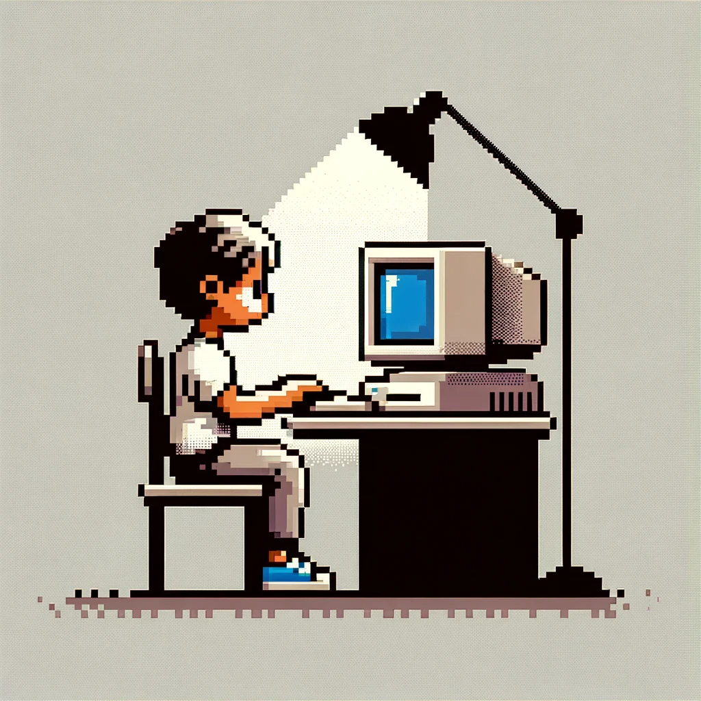

<table>
  <tr>
    <!-- left Column for Text -->
    <td valign="top" width="50%">

# 🪸 Shayan H. 
**`Dynamics Disciple`**

 <!--& Digital Alchemist (Virtual Clinical Trials: FDA Project Optimus)-->

Most of my research projects have tackled theoretical questions in **Pattern Formation** and **Optimal Control** but I've also done some cool experimental immunology in the past. For the first part of my thesis, I am mostly using Julia's **automatic differentiation** packages to perform **Model Predictive Control** on a pharmacokinetic / pharmacodynamic model of Glioblastoma under combination therapy and **Virtual Clinical Trials**. Generally, I'm very interested in **Inverse problems** in dynamical systems, **non-equilibrium phase transitions**, and scuba diving to see water bugs 🪸. Recently I made this web app with my friends... take a look:

    

    </td>
    <!-- Right Column for Image -->
    <td valign="top" width="50%">

My new year's resolution is to read Linda E. Reichl ~ A Modern Course in Statistical Physics (Ilya Prigogine World View)
    </td>
  </tr>
</table>

---

 

#

<!--
**shayshay42/shayshay42** is a ✨ _special_ ✨ repository because its `README.md` (this file) appears on your GitHub profile.

Here are some ideas to get you started:

- 🔭 I’m currently working on ...
- 🌱 I’m currently learning ...
- 👯 I’m looking to collaborate on ...
- 🤔 I’m looking for help with ...
- 💬 Ask me about ...
- 📫 How to reach me: ...
- 😄 Pronouns: ...
- ⚡ Fun fact: ...
-->
